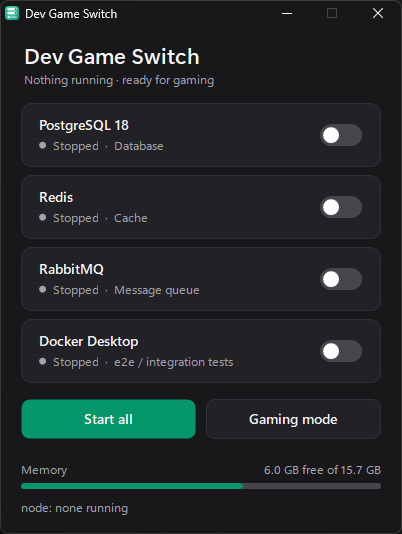

# Dev Game Switch

A small Windows app to start your local dev services when you work and stop them, plus Docker and WSL, before gaming, so nothing dev-related runs in the background.



It controls these by default:

| Service | Windows service name | Started by "Start all" |
|---|---|---|
| PostgreSQL 18 | `postgresql-x64-18` | Yes |
| Redis | `Redis` | Yes |
| RabbitMQ | `RabbitMQ` | Yes |
| Docker Desktop | (app, not a service) | No: only needed for e2e / integration tests |

If your services have different names, see [Use it with your own services](#use-it-with-your-own-services).

## Requirements

- Windows 10 or 11.
- Administrator rights. Windows asks once through UAC each time the app opens, because starting and stopping Windows services needs admin.
- Nothing else to install. The app runs on .NET Framework 4, which is built into Windows.

## Quick start

1. Download [`app/DevGameSwitch.exe`](app/DevGameSwitch.exe), or clone this repo.
2. Double-click `DevGameSwitch.exe` and click **Yes** on the UAC prompt.
3. Optional: right-click `DevGameSwitch.exe` → **Show more options** → **Send to** → **Desktop (create shortcut)**.

> **"Windows protected your PC"?** The exe isn't code-signed, so SmartScreen may block it the first time when you download it from the internet. Click **More info** → **Run anyway**, or build it yourself (see [Building](#building)).

## Using it

- **Toggle switch on a card:** starts or stops that service. While it works, the switch shows a spinner and the status reads *Starting…* or *Stopping…*.
- **Start all:** starts PostgreSQL, Redis and RabbitMQ. It doesn't start Docker; use Docker's own switch when you need it.
- **Gaming mode:** stops everything that's running, then runs `wsl --shutdown`.

Status refreshes every 3 seconds, so services you start or stop elsewhere (for example in `services.msc`) show up too. The header sums it up, e.g. *2 of 4 running* or *Nothing running · ready for gaming*.

The footer shows free memory, plus how many `node` processes are running and how much memory they use. The app never kills node, because VS Code and other tools run on it too. Close those yourself before gaming.

The window follows your Windows light/dark setting (Settings → Personalization → Colors → *Choose your mode*).

### What "stop" does exactly

| Item | On stop |
|---|---|
| PostgreSQL, Redis | Stops the Windows service. |
| RabbitMQ | Stops the service, then kills leftover `epmd`, `erl` and `erlsrv` processes. **This kills every Erlang/Elixir process on the machine**, including your own `iex` or `mix phx.server`. |
| Docker Desktop | Kills `Docker Desktop`, `com.docker.backend` and `com.docker.build`, stops the `com.docker.service` service, then runs `wsl --shutdown`. |
| Gaming mode | All of the above for whatever is running, plus `wsl --shutdown` even if Docker wasn't running, which also stops any WSL distros you have open. |

Starting Docker launches it as your normal user, not as admin, the same way as opening it from the Start menu.

## Use it with your own services

Service names and the Docker path are set in [`app/Program.cs`](app/Program.cs). To change them:

1. Find the exact service names. In PowerShell:
   ```powershell
   Get-Service *postgres*, *redis*, *rabbit*, *mysql*, *mongo* | Format-Table Name, DisplayName, Status
   ```
2. Edit the `Defs` list near the top of `MainForm` in `Program.cs`. There's one line per card:
   ```csharp
   new ServiceDef { Label = "PostgreSQL 18", ServiceName = "postgresql-x64-18", InStartAll = true, Role = "Database" },
   ```
   - `Label`: the name shown on the card.
   - `ServiceName`: the Windows service name from step 1. `null` means Docker Desktop.
   - `InStartAll`: whether **Start all** starts it.
   - `Role`: the short description under the name.
3. If Docker Desktop is installed somewhere else, change `DockerExe` just below the list.
4. [Rebuild](#building).

A service that isn't installed just shows **Not installed**, with its switch disabled.

Tip: set these services' start type to **Manual** in `services.msc` so they don't start with Windows. Then the app decides when they run.

## Building

No SDK is needed. The C# compiler that ships with Windows is enough.

- Double-click [`app/build.cmd`](app/build.cmd), or run it from PowerShell:
  ```powershell
  & .\app\build.cmd
  ```
- The output is `app\DevGameSwitch.exe`.

This compiler (`C:\Windows\Microsoft.NET\Framework64\v4.0.30319\csc.exe`) only supports **C# 5**. That means no `$"..."` string interpolation, no `?.`, no `=>` expression-bodied members and no `nameof`. Use `string.Format`, explicit null checks and normal method bodies instead.

To check the light theme while Windows is in dark mode, add `/define:PREVIEW_LIGHT` to the `csc.exe` line in `build.cmd`, build, and remove it again afterwards.

**For contributors:** `DevGameSwitch.exe` is committed so people can run the app without building it. When you change `Program.cs`, rebuild and commit the new exe in the same commit.

## Files

| File | What it is |
|---|---|
| `app/Program.cs` | The whole app: service list, start/stop logic and UI. |
| `app/build.cmd` | Builds `DevGameSwitch.exe`. |
| `app/app.manifest` | Asks for admin (UAC) and enables sharp text on high-DPI screens. |
| `app/app.ico` | App icon. |
| `app/DevGameSwitch.exe` | Prebuilt app. |
| `dev-services.ps1` | Older script version, no window. `.\dev-services.ps1` starts the services; `.\dev-services.ps1 -Stop` does the same as Gaming mode. It asks for admin by itself. |

## Troubleshooting

- **"Cannot open … service" / "Access is denied":** the app isn't running as admin. Start it again and accept the UAC prompt.
- **A card says *Not installed*:** the service name in `Defs` doesn't match this machine. See [Use it with your own services](#use-it-with-your-own-services).
- **Docker shows *Running* right after stopping:** Docker Desktop can take a few seconds to exit fully. Wait for the next refresh.
- **A service is stuck on *Changing…*:** Windows is still starting or stopping it. If it stays that way, check the service in `services.msc` or its own logs.
